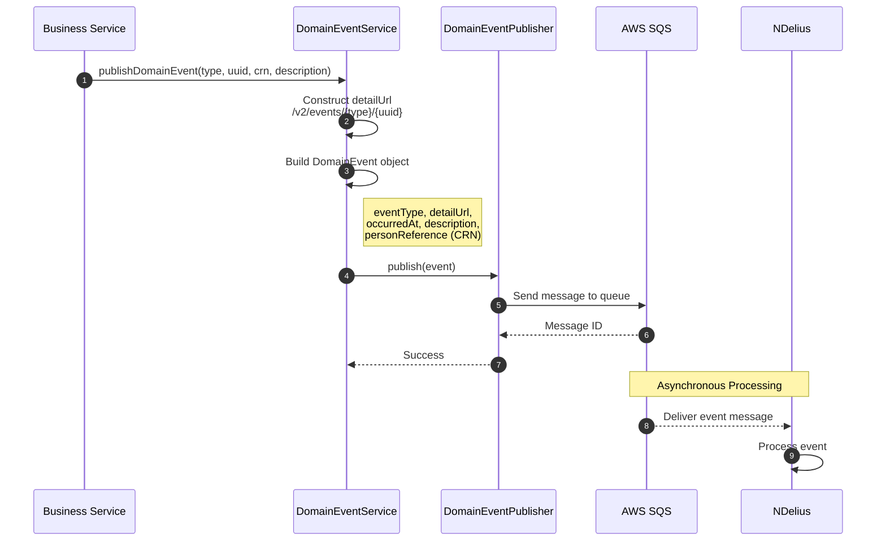
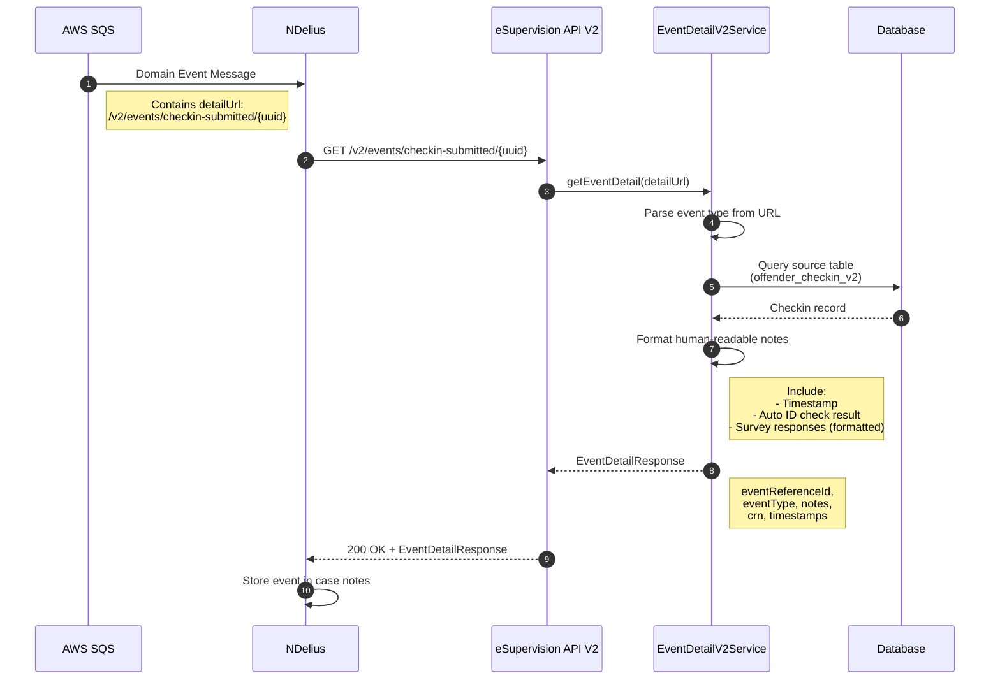
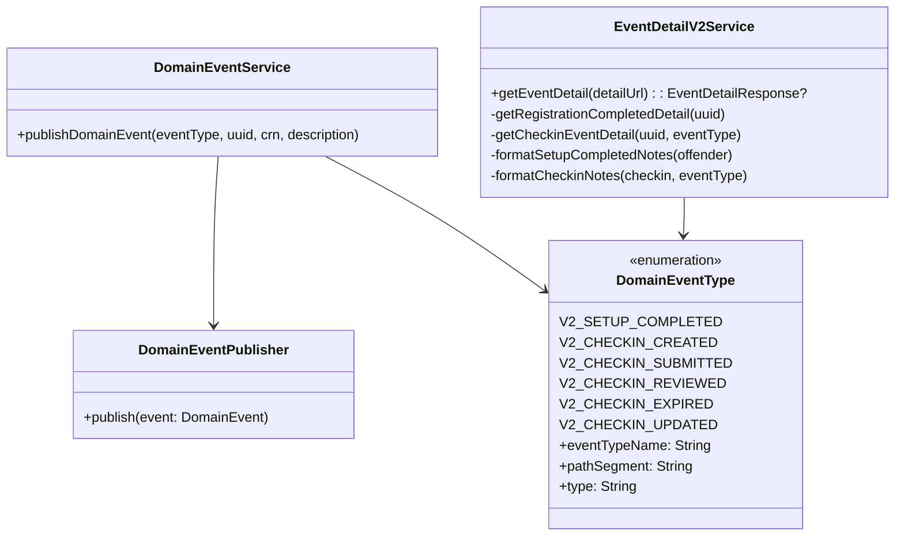

# V2 Domain Events

Domain events are published to AWS SQS for integration with NDelius and other downstream systems.

---

## Event Types

| Event Type | Path Segment | Description | Triggers Case Note |
|------------|--------------|-------------|-------------------|
| `V2_SETUP_COMPLETED` | `setup-completed` | Offender registration completed | Yes |
| `V2_CHECKIN_CREATED` | `checkin-created` | New checkin created | No |
| `V2_CHECKIN_SUBMITTED` | `checkin-submitted` | Offender submitted checkin | Yes |
| `V2_CHECKIN_REVIEWED` | `checkin-reviewed` | Practitioner reviewed checkin | Yes |
| `V2_CHECKIN_EXPIRED` | `checkin-expired` | Checkin marked as expired | Yes |
| `V2_CHECKIN_ANNOTATED` | `checkin-annotated` | Checkin updated (annotated) | Yes |
| `V2_CHECKIN_SCHEDULED` | `checkin-scheduled` | Next check-in scheduled (ESUP-2223) | Yes |
| `V2_CHECKIN_RESCHEDULED` | `checkin-rescheduled` | Scheduled check-in moved to a new date; published as `check-in.updated` (ESUP-2223) | Yes |
| `V2_CHECKIN_CANCELLED` | `checkin-cancelled` | Check-in cancelled before it was submitted (ESUP-2223) | Yes |
| `V2_CHECKIN_LINK_DELIVERED` | `checkin-link-delivered` | Check-in link accepted by GOV.UK Notify (ESUP-2223) | Yes |
| `V2_CHECKIN_LINK_NOT_DELIVERED` | `checkin-link-not-delivered` | Check-in link could not be sent (ESUP-2223) | Yes |

The ESUP-2223 events are not published directly: they are recorded in `checkin_delius_event_v2`
and published in order by `CheckinDeliusEventRelayJob` (see [Background Jobs](BACKGROUND_JOBS.md)).
Their detail URL carries the event's own id (from that table), not the check-in UUID; NDelius
links the contact to the check-in through `checkinUuid` in the detail response.

With feature `ESUP_2223` on, the received, expired, reviewed and updated (annotation) events go
through the same table, recorded in the transaction that changes the check-in, so they can't
overtake the check-in's lifecycle events (NDelius updates the contact `scheduled` created). Their
detail URL and detail response are unchanged.

---

## Upcoming Check-ins (ESUP-2223, feature `ESUP_2223`)

NDelius records each person's next check-in before it is due. `UpcomingCheckinService.scheduleNext`
creates it as a `SCHEDULED` check-in and records a `scheduled` event. Only the next check-in is
recorded: while a check-in is open (`CREATED`), the one after it waits until it is submitted or missed.
Today only counts as the next date before that day's creation job has started (or from the job
itself), because after it nothing would create today's check-in.

| Trigger | Where |
|---------|-------|
| Setup completed | `OffenderSetupPersistenceService.completeOffenderSetupAndMaybeCreateCheckin` |
| Check-ins restarted | `OffenderResource.reactivateOffender` |
| Schedule changed (`update_details`) | `OffenderResource.updateDetails` |
| Ad hoc check-in arranged | `OffenderResource.scheduleAdHocCheckin` |
| Check-in submitted | `CheckinPersistenceService.checkinSubmission` |
| Check-in missed | `CheckinExpiryJob` |
| Scheduled check-in not created on its due date | `CheckinCreationJob` (cancels it, then schedules the next) |

Each trigger makes the upcoming check-in match the schedule. If there is one and the next date
has changed, it is moved, keeping its UUID, and NDelius gets `updated` with the new `dateTime`.
If there's no longer a next date (for example an ad hoc check-in with no date), it is cancelled.
If a check-in is open, an upcoming one alongside it is cancelled. Only upcoming check-ins move:
a created check-in, whose link may have been sent, keeps its date.

Stopping check-ins (by a practitioner, the creation job's eligibility check or the eligibility
sync) cancels the upcoming and open check-ins, and NDelius gets `cancelled` for each one it has,
in the same transaction (`OffenderPersistenceService.offenderDeactivation`). A check-in opened
before the feature was on has no NDelius contact, so it's cancelled without an event: NDelius
would reject an update to a contact it can't find. If the invite was still sending, a link sent
afterwards is marked SENT but not recorded, so it doesn't overwrite the cancellation in NDelius.

Scheduling runs after the triggering transaction commits, in its own transaction, and never fails
the change that triggered it. A check-in created without having been scheduled (no upcoming check-in
for its date, for example someone set up before the feature was on) is recorded as `scheduled` when
it is created, so NDelius always sees `scheduled` first.

### Turning the feature on: backfill

People set up before the feature was on have no upcoming check-in until one of the triggers above
fires. `UpcomingCheckinBackfillJob` schedules it for every verified person with neither an upcoming
nor an open check-in (someone with an open check-in gets the next once it's submitted or missed).
It's safe to run again, and it won't run alongside the check-in creation job.

It runs as a batch CronJob kept suspended (`upcoming-checkin-backfill` in
`helm_deploy/hmpps-esupervision-api/values.yaml`). When turning the feature on in an environment:

1. Turn the flag on (`APP_FEATURES_ESUP_2223`) after that day's 9am creation job has finished.
2. The same day, run the backfill:
   `kubectl create job --from=cronjob/batch-upcoming-checkin-backfill upcoming-checkin-backfill-<date>`
   (or `POST /v2/jobs/upcoming-checkin-backfill/run` where manual triggering is enabled).
3. Check its `job_log_v2` row has `ended_at` set and the log line's `processed` count.

### Check-in link (ESUP-2223)

With the feature on, a check-in is created (or activated) with `link_status` SENDING, and the
invite is sent once that commits (`NotificationOrchestratorService.sendCheckinCreatedNotifications`).
We don't get delivery receipts from GOV.UK Notify, so "sent" means Notify accepted it.

| Outcome | link_status | Check-in | NDelius |
|---------|-------------|----------|---------|
| Notify accepted the invite | SENT | unchanged | `link.delivered` |
| Notify rejected it, or it couldn't be sent (no active event, no contact details, no mobile number or email address for their preference) | FAILED | CANCELLED: not missed, no reminders; questions assigned to it carry over; the practitioner is emailed (`PRACTITIONER_INVITE_ISSUE_GENERIC`); the next check-in is scheduled | `link.not_delivered` |

**Link-sent gate**: a check-in can't be started (identity check) or submitted while it is
SCHEDULED or its link is SENDING (409), so NDelius records the link before the check-in is
received. Check-ins created before the feature have no link status and aren't held.

The creation job doesn't create another check-in for a day whose invite failed, and a failed
check-in keeps its date when the next one is scheduled.

## Event Publishing Flow



---

## Domain Event Structure

```kotlin
data class DomainEvent(
    val eventType: String,           // e.g., "probation-case.checkin.submitted"
    val detailUrl: String,           // Callback URL for event details
    val occurredAt: ZonedDateTime,   // When event occurred
    val description: String,         // Human-readable description
    val personReference: PersonReference,  // CRN identifier
)

data class PersonReference(
    val identifiers: List<PersonIdentifier>,
)

data class PersonIdentifier(
    val type: String,   // "CRN"
    val value: String,  // The actual CRN
)
```

---

## NDelius Callback Flow

When NDelius receives a domain event, it calls back to fetch formatted event details.



---

## Event Detail Response

```kotlin
data class EventDetailResponse(
    val eventReferenceId: String,  // e.g., "V2_CHECKIN_SUBMITTED-{uuid}"
    val eventType: String,         // e.g., "V2_CHECKIN_SUBMITTED"
    val notes: String,             // Human-readable formatted notes
    val crn: String,
    val offenderUuid: UUID,
    val checkinUuid: UUID?,
    val timestamp: Instant,
    val sensitive: Boolean,
    val dateTime: ZonedDateTime?,  // see below
)
```

### dateTime

NDelius uses `dateTime`, when present, as the contact's date and start time.

| Event | dateTime |
|-------|----------|
| scheduled | The scheduled date at 9am Europe/London (check-ins only have a date; 9am is when the creation job sends links) |
| received (submitted) | The submission time (only with feature ESUP_2223 on) |
| updated, for a reschedule | The new scheduled date at 9am Europe/London |
| Every other event (link, cancelled, expired, reviewed, annotation updates) | Absent: NDelius would otherwise move the contact |

### Notes Formatting

The `notes` field contains human-readable text formatted for case notes:

**Setup Completed:**
```
Registration Completed
Offender UUID: {uuid}
CRN: {crn}
Practitioner: {practitionerId}
Status: VERIFIED
First check-in: {date}
Check-in interval: {interval}
```

**Checkin Submitted:**
```
Check in submitted: 15 January 2025 at 2:30pm
Automated ID check: Match

Survey response:
How they have been feeling: Good
Anything they need support with: Housing, Money
If they need us to contact them: Yes
What they want to talk about: Need help with rent
```

**Checkin Updated:**
```
Check in updated: 16 January 2025 at 10:00am
Updated by: U123456
Notes: Spoke to offender about housing issue. Referring to housing officer.
```

---

## Event Callback Endpoints

| Method | Endpoint | Description |
|--------|----------|-------------|
| `GET` | `/v2/events/setup-completed/{uuid}` | Setup completed event details |
| `GET` | `/v2/events/checkin-created/{uuid}` | Checkin created event details |
| `GET` | `/v2/events/checkin-submitted/{uuid}` | Checkin submitted event details |
| `GET` | `/v2/events/checkin-reviewed/{uuid}` | Checkin reviewed event details |
| `GET` | `/v2/events/checkin-expired/{uuid}` | Checkin expired event details |
| `GET` | `/v2/events/checkin-annotated/{uuid}` | Checkin updated (annotated) event details |
| `GET` | `/v2/events/checkin-scheduled/{eventId}` | Checkin scheduled event details |
| `GET` | `/v2/events/checkin-rescheduled/{eventId}` | Checkin rescheduled event details |
| `GET` | `/v2/events/checkin-cancelled/{eventId}` | Checkin cancelled event details |
| `GET` | `/v2/events/checkin-link-delivered/{eventId}` | Checkin link delivered event details |
| `GET` | `/v2/events/checkin-link-not-delivered/{eventId}` | Checkin link not delivered event details |

---

## Service Architecture



---

## Configuration

```yaml
app:
  apiBaseUrl: https://esupervision-api.example.com  # Base URL for detailUrl construction

# SQS configuration
hmpps:
  sqs:
    queues:
      domainevents:
        queueName: esupervision-domain-events
```
